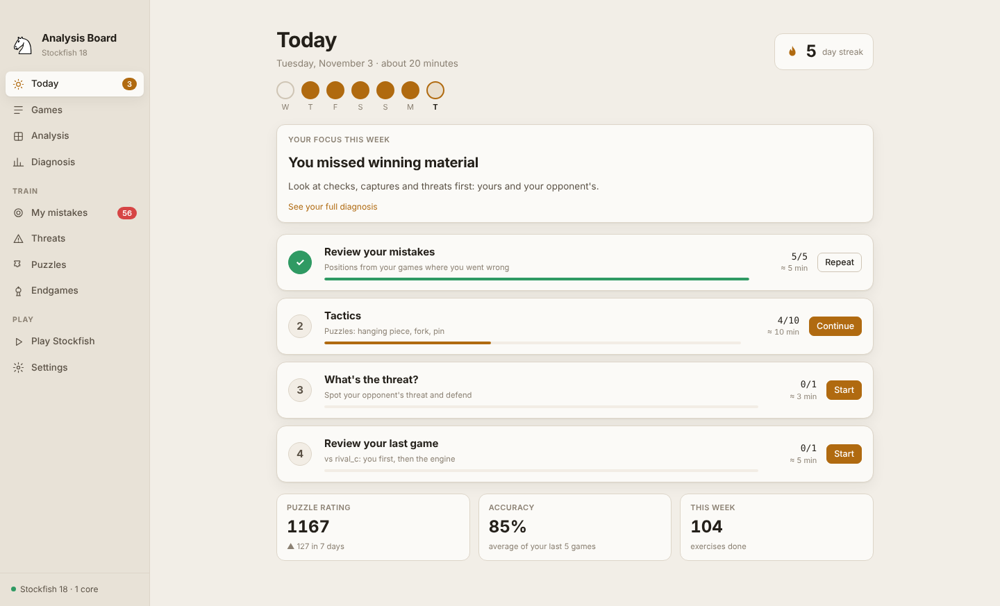
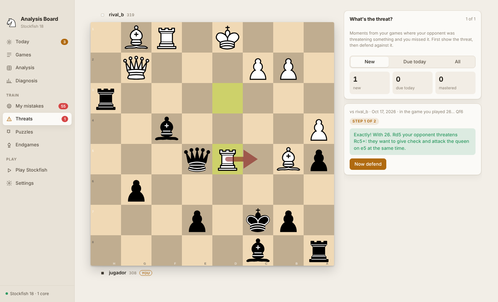
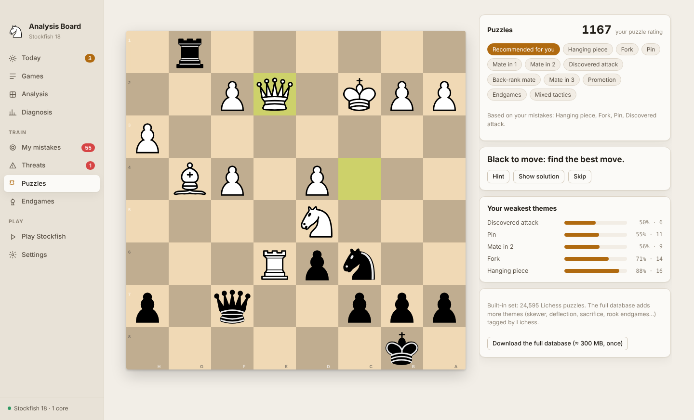
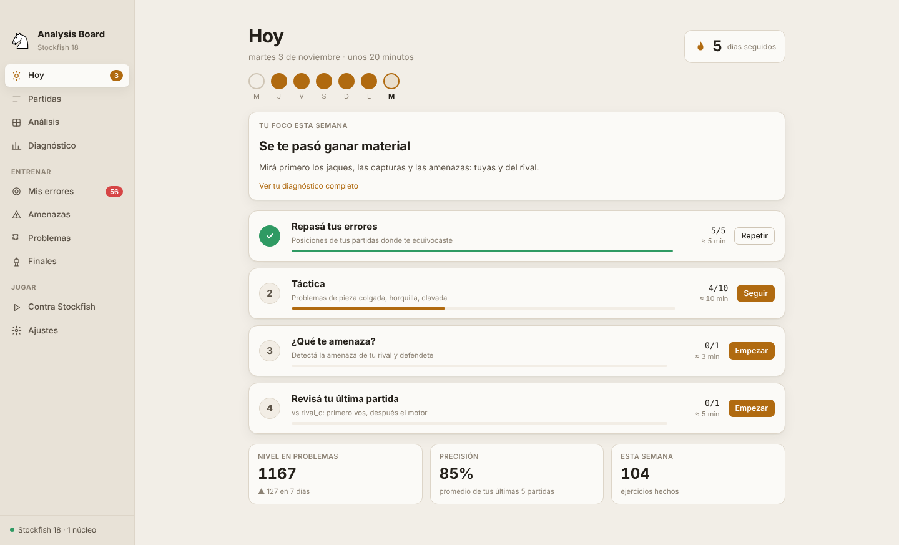
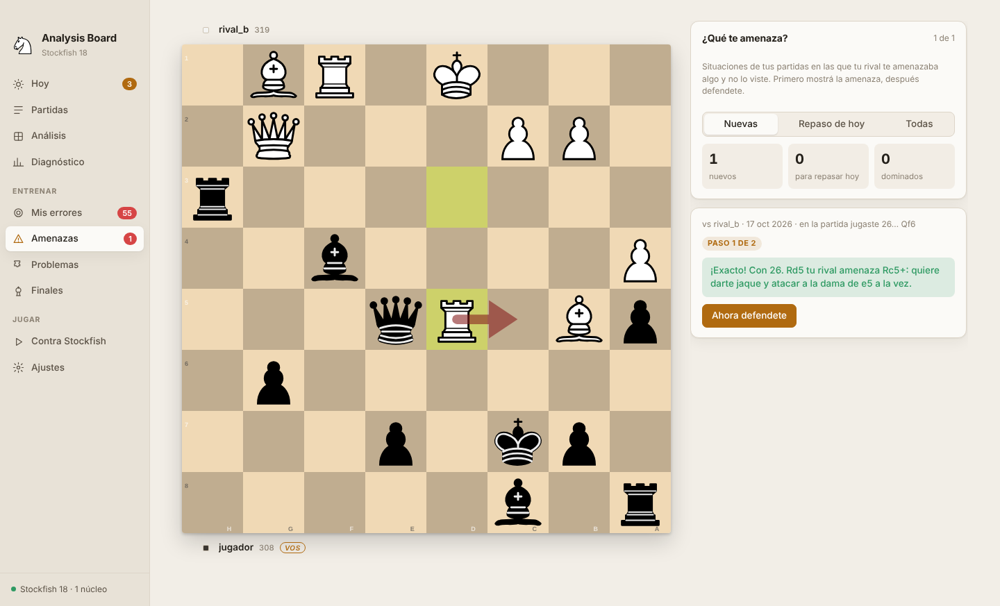
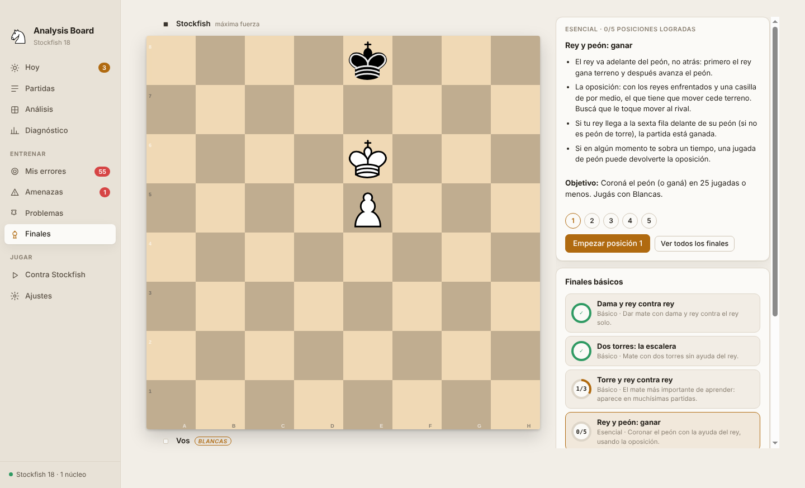

# Analysis Board

**A chess analysis and training app for Mac, powered by Stockfish 18.** It imports your games from Lichess and Chess.com, analyzes every move, explains your mistakes in plain language and turns them into a daily training plan. Everything runs on your computer. In English and Spanish.

[**Leer en español ↓**](#en-español)



## Download

**[⬇ Download Analysis Board for Mac (Apple Silicon)](https://github.com/juanazzurro/analysis-board/releases/latest/download/Analysis-Board-mac.zip)**

Requires a Mac with an Apple chip (M1 or later) and macOS 13 Ventura or newer. All versions and release notes are on the [Releases page](https://github.com/juanazzurro/analysis-board/releases).

### Installing

1. Unzip the file and drag **Analysis Board.app** to your **Applications** folder.
2. The app isn't notarized by Apple (it's a free personal project without a paid developer account), so the first time macOS will refuse to open it and may say it is "damaged". To allow it, open **Terminal** once and run:

   ```sh
   xattr -dr com.apple.quarantine "/Applications/Analysis Board.app"
   ```

3. Open it normally. On first launch the app uses your Mac's language; you can switch between English and Spanish in **Settings → Language**.

### Updating

Download the new `.zip` and choose **Analysis Board → Install update…** in the menu bar (also available in Settings). The app replaces itself and restarts. No Terminal is needed for updates, and your games and progress are kept.

## What it does

| | |
|---|---|
|  |  |
|  |  |

- **Games**: import your latest games from Lichess or Chess.com by username, or paste any PGN. Each game is analyzed in the background with Stockfish 18.
- **Analysis**: every move is classified (best, good, inaccuracy, mistake, blunder) with an explanation in plain words: what you lost, what your opponent threatened and what was better. You can play out any line on the board.
- **Self-review**: for recent games you first mark the moments where you think you went wrong, then compare your review with the engine.
- **Diagnosis**: your recurring mistakes grouped by type (hanging pieces, missed tactics, missed threats, king safety, openings, endgames…), by game phase and under time pressure, with one habit to work on for each.
- **My mistakes**: exercises built from your own errors, scheduled with spaced repetition (1, 3, 7, 21 and 60 days) until you've mastered them.
- **Threats**: positions where your opponent threatened something and you missed it. First spot the threat, then find the defense.
- **Puzzles**: 24,595 built-in Lichess puzzles, recommended according to your weak spots, with an optional download of the full database.
- **Endgames**: the essential endgames (basic mates, king and pawn, the rule of the square, Lucena, Philidor) to practice against Stockfish.
- **Play Stockfish**: 10 levels, from about 600 to full strength, then analyze the game you just played.
- **Today**: a short daily plan that mixes all of the above, with a weekly focus and a streak.
- **Dark mode** that follows your Mac's appearance.



### Privacy

Your games, analysis and progress are stored only on your Mac (in `~/Library/Application Support`). The app connects to the internet only to import games from Lichess or Chess.com, to download the optional full puzzle database, and, if you add your own Anthropic API key in Settings, for optional AI explanations. Without a key everything works offline.

## Building from source

You need Node.js 20 or newer.

```sh
git clone https://github.com/juanazzurro/analysis-board.git
cd analysis-board
npm install

# Run in development (point it to any Stockfish binary)
STOCKFISH_PATH=/opt/homebrew/bin/stockfish npm start

# Build "Analysis Board.app" and the zip in dist/
npm run package:mac
```

`npm run package:mac` downloads Electron 45 and the official Stockfish 18 build for Apple Silicon, assembles the app bundle and signs it ad hoc. It works on macOS (`codesign`, `ditto`) and also on Linux (with [`rcodesign`](https://github.com/indygreg/apple-platform-rs) on the `PATH`).

The interface lives in `src/` (plain JavaScript modules bundled with esbuild into `renderer/`), and the Electron main process is in `main.js`. All text is bilingual through `tr("español", "English")` in `src/i18n.js`.

## Credits and licenses

Analysis Board is free software under the [GNU GPL v3 or later](LICENSE).

- [Stockfish 18](https://stockfishchess.org): GPL-3.0
- [chessground](https://github.com/lichess-org/chessground) (the board, from Lichess): GPL-3.0
- Pieces "cburnett" by Colin M.L. Burnett: CC BY-SA 3.0
- [chess.js](https://github.com/jhlywa/chess.js): BSD-2-Clause
- [fzstd](https://github.com/101arrowz/fzstd): MIT
- [Electron](https://www.electronjs.org): MIT
- Puzzles from the [Lichess puzzle database](https://database.lichess.org/#puzzles): CC0

Not affiliated with Lichess, Chess.com or the Stockfish project.

---

## En español

**Una app de análisis y entrenamiento de ajedrez para Mac, con Stockfish 18.** Importa tus partidas de Lichess y Chess.com, analiza cada jugada, te explica tus errores con palabras simples y los convierte en un plan de entrenamiento diario. Todo funciona en tu computadora. En castellano y en inglés.



### Descarga

**[⬇ Descargar Analysis Board para Mac (Apple Silicon)](https://github.com/juanazzurro/analysis-board/releases/latest/download/Analysis-Board-mac.zip)**

Necesita una Mac con chip de Apple (M1 o posterior) y macOS 13 Ventura o más nuevo. Todas las versiones y sus novedades están en la [página de versiones](https://github.com/juanazzurro/analysis-board/releases).

#### Instalación

1. Descomprimí el archivo y arrastrá **Analysis Board.app** a la carpeta **Aplicaciones**.
2. La app no está notarizada por Apple (es un proyecto personal y gratuito, sin cuenta paga de desarrollador), así que la primera vez macOS no la deja abrir y puede decir que "está dañada". Para habilitarla, abrí la **Terminal** una sola vez y escribí:

   ```sh
   xattr -dr com.apple.quarantine "/Applications/Analysis Board.app"
   ```

3. Abrila normalmente. La primera vez usa el idioma de tu Mac; lo podés cambiar en **Ajustes → Idioma**.

#### Actualizaciones

Bajá el `.zip` nuevo y elegí **Analysis Board → Instalar actualización…** en la barra de menú (también está en Ajustes). La app se reemplaza sola y se vuelve a abrir. No hace falta la Terminal y se conservan tus partidas y tu progreso.

> ¿Usabas la versión anterior, "Mesa de Análisis"? Instalá esta con **Instalar actualización…** como siempre: la app pasa a llamarse Analysis Board, sigue en castellano y conserva todo.

### Qué hace

| | |
|---|---|
|  |  |
|  |  |

- **Partidas**: importá tus últimas partidas de Lichess o Chess.com con tu usuario, o pegá cualquier PGN. Cada partida se analiza en segundo plano con Stockfish 18.
- **Análisis**: cada jugada se clasifica (mejor, buena, imprecisión, error, blunder) con una explicación simple: qué perdiste, qué amenazaba tu rival y qué era mejor. Podés probar cualquier línea en el tablero.
- **Revisión propia**: en las partidas recientes primero marcás dónde creés que te equivocaste y después comparás tu revisión con el motor.
- **Diagnóstico**: tus errores repetidos agrupados por tipo (piezas colgadas, tácticas, amenazas que no viste, seguridad del rey, aperturas, finales…), por fase de la partida y con poco reloj, con un hábito para trabajar en cada uno.
- **Mis errores**: ejercicios armados con tus propios errores, con repaso espaciado (1, 3, 7, 21 y 60 días) hasta que los dominás.
- **Amenazas**: posiciones donde tu rival amenazaba algo y no lo viste. Primero encontrás la amenaza y después la defensa.
- **Problemas**: 24.595 problemas de Lichess incluidos, recomendados según tus puntos débiles, con la opción de bajar la base completa.
- **Finales**: los finales esenciales (mates básicos, rey y peón, la regla del cuadrado, Lucena, Philidor) para practicar contra Stockfish.
- **Contra Stockfish**: 10 niveles, desde unos 600 de Elo hasta la fuerza máxima, y después analizás la partida que jugaste.
- **Hoy**: un plan diario corto que mezcla todo lo anterior, con un foco semanal y una racha.
- **Modo oscuro** que sigue la apariencia de tu Mac.



#### Privacidad

Tus partidas, análisis y progreso se guardan solo en tu Mac (en `~/Library/Application Support`). La app se conecta a internet únicamente para importar partidas de Lichess o Chess.com, para bajar la base completa de problemas (opcional) y, si cargás tu propia clave de la API de Anthropic en Ajustes, para las explicaciones con IA (opcionales). Sin clave, todo funciona sin conexión.

### Compilar desde el código

Las instrucciones están [más arriba, en inglés](#building-from-source): `npm install`, `npm start` para desarrollo y `npm run package:mac` para armar la app.

### Créditos y licencias

Analysis Board es software libre bajo la [GNU GPL v3 o posterior](LICENSE). Usa Stockfish 18 (GPL-3.0), chessground de Lichess (GPL-3.0), las piezas "cburnett" de Colin M.L. Burnett (CC BY-SA 3.0), chess.js (BSD-2-Clause), fzstd (MIT), Electron (MIT) y los problemas de la base de Lichess (CC0). No está afiliada a Lichess, Chess.com ni al proyecto Stockfish.
