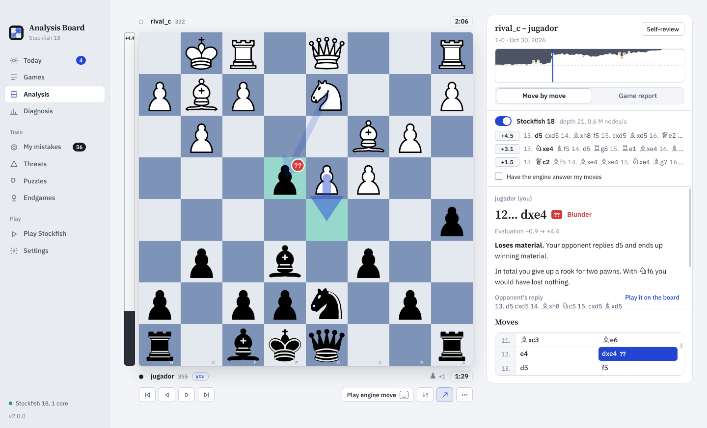
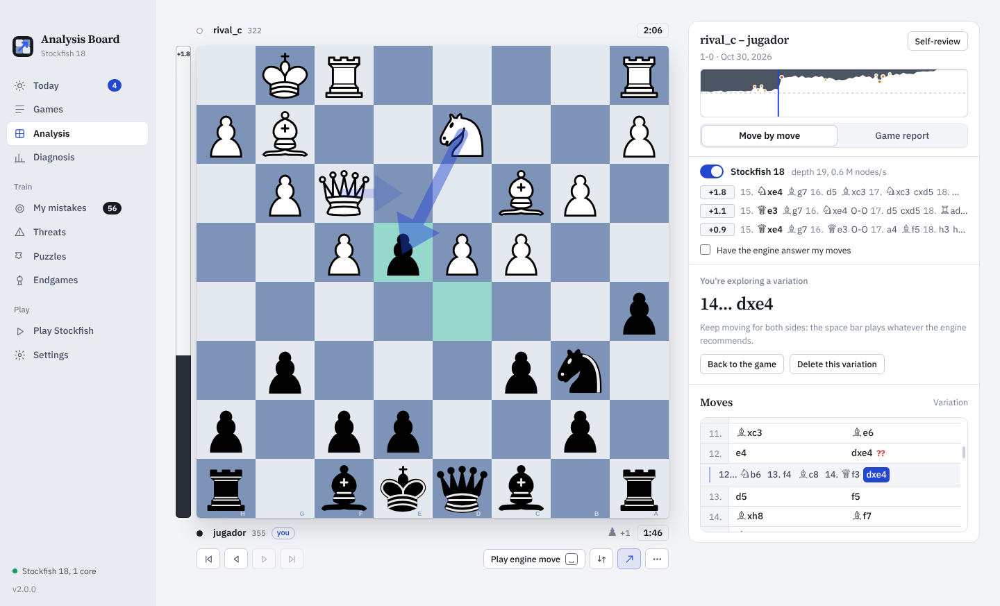
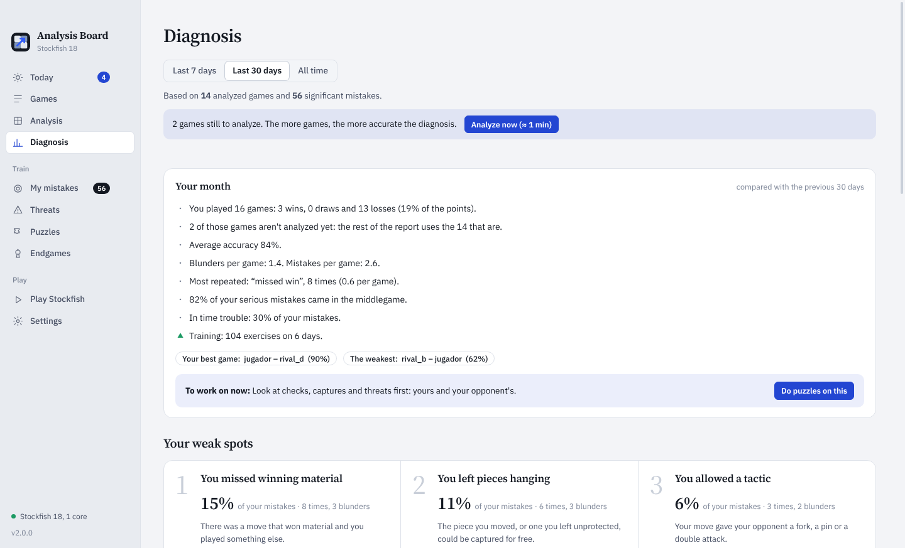
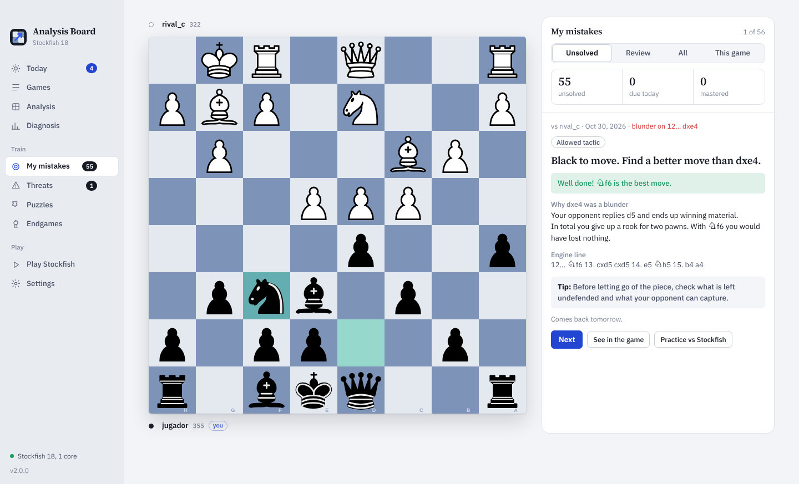
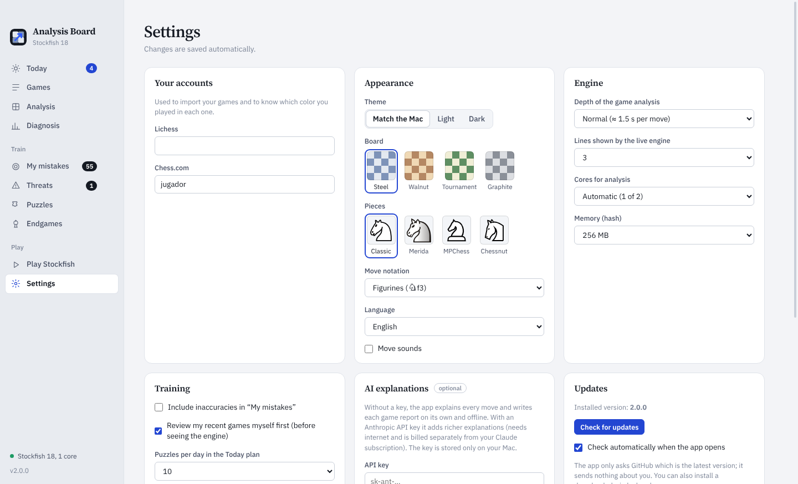
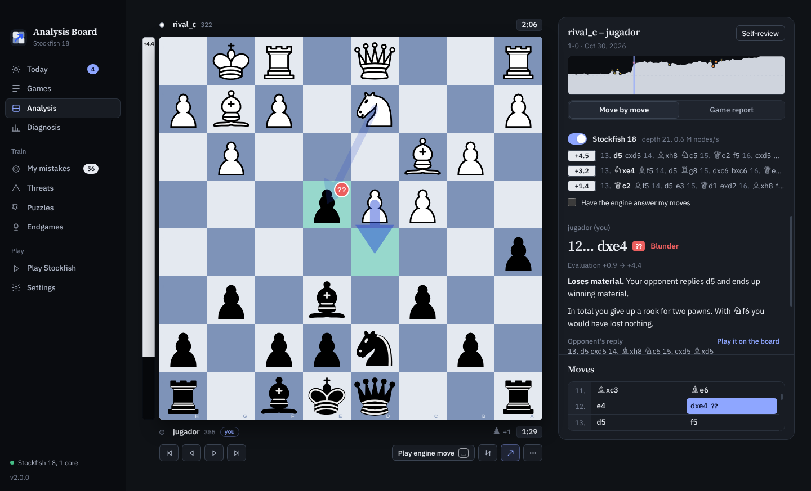
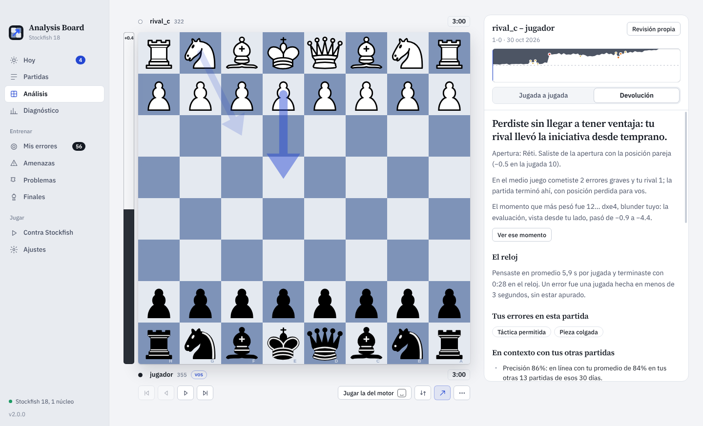
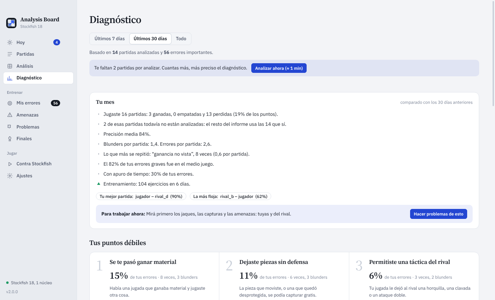
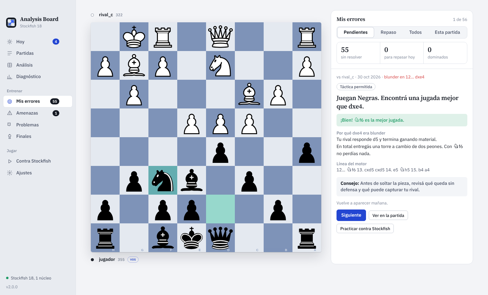
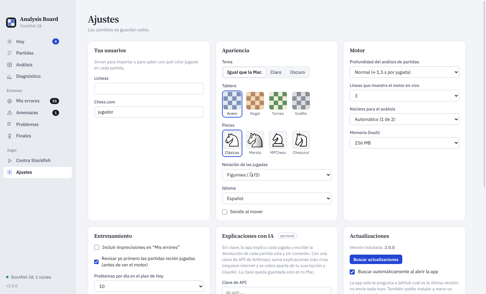

# Analysis Board

**A chess analysis and training app for Mac, powered by Stockfish 18.** It imports your games from Lichess and Chess.com, analyzes every move, writes you a report on each game and on your week and month, and turns your mistakes into a daily training plan. Everything runs on your computer. In English and Spanish.

[**Leer en español ↓**](#en-español)



## Download

**[⬇ Download Analysis Board for Mac (Apple Silicon)](https://github.com/juanazzurro/analysis-board/releases/latest/download/Analysis-Board-mac.zip)**

Requires a Mac with an Apple chip (M1 or later) and macOS 13 Ventura or newer. All versions and release notes are on the [Releases page](https://github.com/juanazzurro/analysis-board/releases).

### Installing

1. Unzip the file and drag **Analysis Board.app** to your **Applications** folder.
2. The app isn't notarized by Apple (it's an independent project without a paid developer account), so the first time macOS will refuse to open it and may say it is "damaged". To allow it, open **Terminal** once and run:

   ```sh
   xattr -dr com.apple.quarantine "/Applications/Analysis Board.app"
   ```

3. Open it normally. On first launch the app uses your Mac's language; you can switch between English and Spanish in **Settings**.

### Updating

From version 2 on, the app tells you when a new version is out and updates itself with one click (**Settings → Updates**, or the notice in the sidebar). It only asks GitHub which the latest version is; you can turn the automatic check off. Your games and progress are kept. If you come from version 1.x, download the `.zip` and use **Install update…** in the app menu one last time.

## What it does

| | |
|---|---|
|  |  |
|  |  |

**Analyze**

- **Games**: import your latest games from Lichess or Chess.com by username, open or drag in PGN files, or paste a PGN. Each game is analyzed in the background with Stockfish 18. Filter by result and time control, sort by date or accuracy.
- **Move by move**: every move is classified (best, good, inaccuracy, mistake, blunder) with an explanation in plain words: what you lost, what your opponent threatened and what was better.
- **Live engine**: at any position Stockfish shows its best lines. Click a move in a line to see it on the board, or press the space bar to play the engine's recommendation, for your side or your opponent's. You can also have the engine answer your moves automatically.
- **Variations**: move the pieces anywhere in a game to try other ideas. Variations can branch and nest, they are saved with the game and exported in the PGN.
- **Free board**: analyze any position from a FEN, or enter a game by hand and save it.
- **Self-review**: for recent games you first mark the moments where you think you went wrong, then compare your review with the engine.

**Understand**

- **Game report**: a written report for every game: how it unfolded phase by phase, the moment that decided it, how you used the clock, and how it compares with your other games of the week and month (accuracy against your average, whether the mistakes are the ones you keep repeating, your record with that opening).
- **Diagnosis**: your recurring mistakes grouped by type (hanging pieces, missed tactics, missed threats, king safety, openings, endgames…), by game phase and under time pressure, with one habit to work on for each.
- **Weekly and monthly report**: results, accuracy, blunders per game, what improved and what got worse compared with the previous period, your best and weakest game.

**Train**

- **My mistakes**: exercises built from your own errors, scheduled with spaced repetition (1, 3, 7, 21 and 60 days) until you've mastered them.
- **Threats**: positions where your opponent threatened something and you missed it. First spot the threat, then find the defense.
- **Puzzles**: 24,595 built-in Lichess puzzles, recommended according to your weak spots, with an optional download of the full database.
- **Endgames**: the essential endgames (basic mates, king and pawn, the rule of the square, Lucena, Philidor) to practice against Stockfish.
- **Play Stockfish**: 10 levels, from about 600 to full strength, with hints, then analyze the game you just played.
- **Today**: a short daily plan that mixes all of the above, with a weekly focus and a streak.

**Make it yours**

- Figurine notation (♘f3), Spanish letters (Cf3) or English letters (Nf3).
- Four board themes and four piece sets; light and dark themes.
- Copy FEN and PGN, export games, and back up or restore all your data in one file.





### Keyboard

| Key | Action |
|---|---|
| ← → | Previous and next move |
| ↑ ↓ | Previous and next mistake in the game |
| Space | Play the engine's recommended move on the board |
| F, A | Flip the board, show or hide the engine arrows |
| ⌫, Esc | Delete the current variation, go back to the game |
| ⌘1 … ⌘9 | Switch section |
| ⌘N, ⌘O, ⌘S | Free board, open a PGN file, export the open game |
| ? | Show all shortcuts |

### Privacy

Your games, analysis and progress are stored only on your Mac (in `~/Library/Application Support`), with an automatic daily copy. The app connects to the internet only to import games from Lichess or Chess.com, to download the optional full puzzle database, to ask GitHub whether there is a new version (optional), and, if you add your own Anthropic API key in Settings, for optional AI explanations. Without a key everything works offline.

## Building from source

You need Node.js 20 or newer.

```sh
git clone https://github.com/juanazzurro/analysis-board.git
cd analysis-board
npm install

# Run in development (point it to any Stockfish binary)
STOCKFISH_PATH=/opt/homebrew/bin/stockfish npm start

# Build "Analysis Board.app" and the zip in dist/
npm run package:mac
```

`npm run package:mac` downloads Electron 45 and the official Stockfish 18 build for Apple Silicon, assembles the app bundle and signs it ad hoc. It works on macOS (`codesign`, `ditto`) and also on Linux (with [`rcodesign`](https://github.com/indygreg/apple-platform-rs) on the `PATH`).

The interface lives in `src/` (plain JavaScript modules bundled with esbuild into `renderer/`), and the Electron main process is in `main.js`. All text is bilingual through `tr("español", "English")` in `src/i18n.js`. Tests for the analysis logic are in `test/` (see the header of each file for how to run it).

## Credits and licenses

Analysis Board is free software under the [GNU GPL v3 or later](LICENSE). It builds on [Stockfish 18](https://stockfishchess.org), [chessground](https://github.com/lichess-org/chessground) and [chess.js](https://github.com/jhlywa/chess.js), free piece sets, open typefaces (Source Serif 4, IBM Plex Sans) and the [Lichess puzzle database](https://database.lichess.org/#puzzles). The full list with authors and licenses is in [THIRD-PARTY.md](THIRD-PARTY.md).

Not affiliated with Lichess, Chess.com or the Stockfish project.

---

## En español

**Una app de análisis y entrenamiento de ajedrez para Mac, con Stockfish 18.** Importa tus partidas de Lichess y Chess.com, analiza cada jugada, te escribe una devolución de cada partida y un informe de tu semana y de tu mes, y convierte tus errores en un plan de entrenamiento diario. Todo funciona en tu computadora. En castellano y en inglés.


### Descarga

**[⬇ Descargar Analysis Board para Mac (Apple Silicon)](https://github.com/juanazzurro/analysis-board/releases/latest/download/Analysis-Board-mac.zip)**

Necesita una Mac con chip de Apple (M1 o posterior) y macOS 13 Ventura o más nuevo. Todas las versiones y sus novedades están en la [página de versiones](https://github.com/juanazzurro/analysis-board/releases).

#### Instalación

1. Descomprimí el archivo y arrastrá **Analysis Board.app** a la carpeta **Aplicaciones**.
2. La app no está notarizada por Apple (es un proyecto independiente, sin cuenta paga de desarrollador), así que la primera vez macOS no la deja abrir y puede decir que "está dañada". Para habilitarla, abrí la **Terminal** una sola vez y escribí:

   ```sh
   xattr -dr com.apple.quarantine "/Applications/Analysis Board.app"
   ```

3. Abrila normalmente. La primera vez usa el idioma de tu Mac; lo podés cambiar en **Ajustes**.

#### Actualizaciones

Desde la versión 2, la app te avisa cuando sale una versión nueva y se actualiza sola con un clic (**Ajustes → Actualizaciones**, o el aviso de la barra lateral). Solo le pregunta a GitHub cuál es la última versión, y la búsqueda automática se puede apagar. Se conservan tus partidas y tu progreso. Si venís de la versión 1.x, bajá el `.zip` y usá **Instalar actualización…** del menú de la app una última vez.

### Qué hace

| | |
|---|---|
|  |  |
|  |  |

**Analizar**

- **Partidas**: importá tus últimas partidas de Lichess o Chess.com con tu usuario, abrí o arrastrá archivos PGN, o pegá un PGN. Cada partida se analiza en segundo plano con Stockfish 18. Filtrá por resultado y ritmo, ordená por fecha o precisión.
- **Jugada a jugada**: cada jugada se clasifica (mejor, buena, imprecisión, error, blunder) con una explicación simple: qué perdiste, qué amenazaba tu rival y qué era mejor.
- **Motor en vivo**: en cualquier posición Stockfish muestra sus mejores líneas. Tocá una jugada de una línea para verla en el tablero, o apretá la barra espaciadora para jugar la que recomienda, para tu bando o el de tu rival. También podés hacer que el motor responda solo a tus jugadas.
- **Variantes**: mové las piezas en cualquier momento de una partida para probar otras ideas. Las variantes se pueden ramificar y anidar, quedan guardadas con la partida y salen en el PGN.
- **Tablero libre**: analizá cualquier posición desde un FEN, o cargá una partida a mano y guardala.
- **Revisión propia**: en las partidas recientes primero marcás dónde creés que te equivocaste y después comparás tu revisión con el motor.

**Entender**

- **Devolución de la partida**: un texto para cada partida: cómo se desarrolló etapa por etapa, el momento que la decidió, cómo usaste el reloj y cómo se compara con tus otras partidas de la semana y del mes (precisión contra tu promedio, si los errores son los que venís repitiendo, cómo te va con esa apertura).
- **Diagnóstico**: tus errores repetidos agrupados por tipo (piezas colgadas, tácticas, amenazas que no viste, seguridad del rey, aperturas, finales…), por etapa de la partida y con poco reloj, con un hábito para trabajar en cada uno.
- **Informe semanal y mensual**: resultados, precisión, blunders por partida, qué mejoró y qué empeoró respecto del período anterior, tu mejor partida y la más floja.

**Entrenar**

- **Mis errores**: ejercicios armados con tus propios errores, con repaso espaciado (1, 3, 7, 21 y 60 días) hasta que los dominás.
- **Amenazas**: posiciones donde tu rival amenazaba algo y no lo viste. Primero encontrás la amenaza y después la defensa.
- **Problemas**: 24.595 problemas de Lichess incluidos, recomendados según tus puntos débiles, con la opción de bajar la base completa.
- **Finales**: los finales esenciales (mates básicos, rey y peón, la regla del cuadrado, Lucena, Philidor) para practicar contra Stockfish.
- **Contra Stockfish**: 10 niveles, desde unos 600 de Elo hasta la fuerza máxima, con pistas, y después analizás la partida que jugaste.
- **Hoy**: un plan diario corto que mezcla todo lo anterior, con un foco semanal y una racha.

**A tu gusto**

- Notación con figurines (♘f3), con letras en castellano (Cf3) o en inglés (Nf3).
- Cuatro tableros y cuatro juegos de piezas; tema claro y oscuro.
- Copiar FEN y PGN, exportar partidas, y guardar o restaurar todos tus datos en un archivo.



#### Teclado

| Tecla | Acción |
|---|---|
| ← → | Jugada anterior y siguiente |
| ↑ ↓ | Error anterior y siguiente de la partida |
| Espacio | Jugar en el tablero la jugada que recomienda el motor |
| F, A | Girar el tablero, mostrar u ocultar las flechas del motor |
| ⌫, Esc | Borrar la variante actual, volver a la partida |
| ⌘1 … ⌘9 | Cambiar de sección |
| ⌘N, ⌘O, ⌘S | Tablero libre, abrir un archivo PGN, exportar la partida abierta |
| ? | Ver todos los atajos |

#### Privacidad

Tus partidas, análisis y progreso se guardan solo en tu Mac (en `~/Library/Application Support`), con una copia automática por día. La app se conecta a internet únicamente para importar partidas de Lichess o Chess.com, para bajar la base completa de problemas (opcional), para preguntarle a GitHub si hay una versión nueva (opcional) y, si cargás tu propia clave de la API de Anthropic en Ajustes, para las explicaciones con IA (opcionales). Sin clave, todo funciona sin conexión.

### Compilar desde el código

Las instrucciones están [más arriba, en inglés](#building-from-source): `npm install`, `npm start` para desarrollo y `npm run package:mac` para armar la app.

### Créditos y licencias

Analysis Board es software libre bajo la [GNU GPL v3 o posterior](LICENSE). Usa Stockfish 18, chessground, chess.js, juegos de piezas libres, tipografías abiertas (Source Serif 4, IBM Plex Sans) y la base de problemas de Lichess. La lista completa, con autores y licencias, está en [THIRD-PARTY.md](THIRD-PARTY.md). No está afiliada a Lichess, Chess.com ni al proyecto Stockfish.
